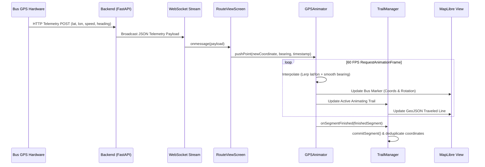

# DUK-BusTracker: Android & Frontend Technical Documentation

Comprehensive architectural and engineering reference for the **DUK-BusTracker** mobile client application (Android & React Native).

---

## 1. System Overview

The **DUK-BusTracker** frontend is a high-performance, real-time campus transit tracking application engineered with **React Native (v0.86.0)**, **React 19**, **TypeScript**, and **MapLibre Native**. It connects university students, faculty, and administrative staff with live transit telemetry broadcasted by campus shuttle buses at Digital University Kerala (DUK).

### Key Architectural Pillars
- **Ultra-Smooth Telemetry Rendering**: Custom client-side interpolation (`GPSAnimator`) and route-snapped trail stitching (`TrailManager`) eliminate GPS jitter and jumpiness.
- **Dual Visual Modes**: Synchronized viewports featuring an interactive vector map (MapLibre GL) alongside a linear stop-by-stop progress timeline.
- **Enterprise-Grade Push Notifications**: Powered by Firebase Cloud Messaging (FCM) and Android 13+ runtime notification permissions.
- **Robust Network Resilience**: Automatic WebSocket reconnection, exponential backoff, offline route caching via AsyncStorage, and 30-second Axios API timeouts.
- **Modern Android Native Runtime**: Built on Kotlin, Gradle 8+, Android SDK 36 (target/compile), Hermes JavaScript engine, and native boot-splash orchestration.

```mermaid
flowchart TD
    subgraph Cloud["Backend Infrastructure"]
        BE[FastAPI REST Backend]
        WS[WebSocket Live Stream]
        FCM[Firebase Cloud Messaging]
    end

    subgraph NativeAndroid["Android Native Layer (Kotlin/C++)"]
        MA[MainActivity.kt / RNBootSplash]
        APP[MainApplication.kt / ReactHost]
        HERMES[Hermes Bytecode Engine]
        MAP_NATIVE[MapLibre Native C++ Engine]
    end

    subgraph RNApp["React Native Core (TypeScript)"]
        NAV[Navigation Stack: @react-navigation]
        API[Axios API Client + JWT Interceptors]
        STORAGE[AsyncStorage Layer]
        WS_CLIENT[WebSocket Telemetry Handler]
        ANIM[GPSAnimator + TrailManager]
        FCM_SVC[Firebase Push Notification Service]
    end

    subgraph Views["User Screens & Components"]
        RV[RouteViewScreen (Map & Timeline)]
        OTP[OtpVerifyScreen (Auth)]
        PROF[ProfileSetupScreen]
        SET[SettingsScreen]
        HELP[HelpScreen & Timetables]
        MODALS[DrawerMenu / AppUpdate / Alerts]
    end

    BE <-->|REST API / JWT| API
    WS -->|Live Telemetry Coordinates| WS_CLIENT
    FCM -->|Push Broadcasts| FCM_SVC
    APP --> HERMES --> RNApp
    MAP_NATIVE <--> RV
    WS_CLIENT --> ANIM --> RV
    API --> STORAGE
    NAV --> Views
```

---

## 2. Directory Structure

```
frontend/
├── android/                         # Native Android Project
│   ├── app/
│   │   ├── build.gradle             # Application-level Gradle configuration
│   │   ├── proguard-rules.pro       # Release build minification rules
│   │   └── src/main/
│   │       ├── AndroidManifest.xml  # App permissions and activity declarations
│   │       ├── java/com/bustracker/
│   │       │   ├── MainActivity.kt  # ReactActivity entry point & bootsplash init
│   │       │   └── MainApplication.kt # ReactApplication, ReactHost & network setup
│   │       └── res/                 # Drawables, mipmaps, values, sound assets
│   ├── build.gradle                 # Project-level Gradle build configuration
│   └── gradle.properties            # SDK versions, JVM arguments, Hermes flag
├── docs/                            # Technical Documentation
│   ├── Android_Frontend.md          # Comprehensive Frontend & Android Documentation
│   ├── Firebase_Service.md          # Push notification technical specs
│   └── Trailing_Implementation.md   # Map & timeline trailing mechanics
├── src/                             # React Native Source Code (TypeScript)
│   ├── assets/                      # Bundled images, logos, and static graphics
│   ├── components/                  # Reusable UI components & modals
│   │   ├── AboutModal.tsx           # Credits, developers & supervisor modal
│   │   ├── AppUpdateModal.tsx       # Mandatory/recommended app update dialog
│   │   ├── BusIdleAnimation.tsx     # Animated state when bus is stationary/inactive
│   │   ├── DrawerMenu.tsx           # Lateral sliding drawer navigation
│   │   ├── NotificationDrawer.tsx   # Expandable broadcast history list
│   │   ├── NotificationPopup.tsx    # Slide-up modal for urgent notifications
│   │   ├── OtpModal.tsx             # Modal-based OTP authentication prompt
│   │   └── TopBar.tsx               # Top header with route picker, status & mute
│   ├── screens/                     # Primary user application screens
│   │   ├── HelpScreen.tsx           # Transit timetable, FAQs, emergency contacts
│   │   ├── OtpVerifyScreen.tsx      # Passwordless email OTP verification screen
│   │   ├── ProfileSetupScreen.tsx   # User profile and notification preferences
│   │   ├── RouteViewScreen.tsx      # Core live tracking dashboard (Map + Timeline)
│   │   └── SettingsScreen.tsx       # Notification config, alerts & account settings
│   ├── services/                    # Networking, persistence, and external bridges
│   │   ├── api.ts                   # Axios client with base URL auto-config & JWT
│   │   ├── firebaseService.ts       # FCM token registration & notification listeners
│   │   ├── navigation.ts            # Type-safe navigation helper methods
│   │   └── storage.ts               # AsyncStorage wrappers for tokens & preferences
│   ├── theme/                       # Color palettes, design tokens & typography
│   │   └── colors.ts                # Application color tokens & semantic styling
│   ├── types/                       # TypeScript ambient definitions
│   │   └── env.d.ts                 # Environment variable declarations
│   └── utils/                       # Mathematical & algorithmic utility engines
│       ├── gpsAnimator.ts           # Physics-based coordinate & bearing interpolator
│       ├── math.ts                  # Haversine distance & geographic calculations
│       └── trailManager.ts          # Polyline snapping, trail stitching & GeoJSON
├── __tests__/                       # Automated test suites
│   └── tracking_and_trail.test.mjs  # Unit tests for animation & trail logic
├── package.json                     # Dependencies, scripts, and build targets
└── tsconfig.json                    # TypeScript compiler configuration
```

---

## 3. Native Android Configuration

### 3.1 SDK & Build Specifications
The Android subsystem is defined in [android/build.gradle](file:///c:/Users/khais/Documents/GitHub/DUK-BusTracker/frontend/android/build.gradle) and [android/app/build.gradle](file:///c:/Users/khais/Documents/GitHub/DUK-BusTracker/frontend/android/app/build.gradle):

| Setting | Value | Rationale |
| :--- | :--- | :--- |
| **`compileSdkVersion`** | `36` | Target the latest Android 15/16 APIs and modern system services. |
| **`targetSdkVersion`** | `36` | Strict compliance with Google Play Store modern runtime requirements. |
| **`minSdkVersion`** | `24` | Android 7.0 (Nougat) minimum, reaching ~97% of active Android devices. |
| **`buildToolsVersion`** | `36.0.0` | Latest compiler toolchain. |
| **`ndkVersion`** | `27.1.12297006` | Native Development Kit for MapLibre C++ and Hermes compilation. |
| **`kotlinVersion`** | `2.1.20` | Kotlin 2.x runtime with first-class coroutine support. |
| **Hermes Engine** | `true` | Precompiled AOT bytecode for sub-second startup times and low RAM usage. |

### 3.2 ABI Splits & Binary Packaging
In `android/app/build.gradle`, ABI splits are configured to optimize APK file size for end users:
- **Splits Enabled**: Generates targeted `.apk` files for `armeabi-v7a`, `arm64-v8a`, `x86`, and `x86_64`.
- **Universal APK**: `universalApk true` generates a comprehensive fallback APK (~40MB) capable of installing on any Android architecture.
- **ProGuard**: `enableProguardInReleaseBuilds = true` strips unused Java/Kotlin bytecode and shrinks release APKs down to ~18MB.

### 3.3 Permissions Architecture
Configured in [android/app/src/main/AndroidManifest.xml](file:///c:/Users/khais/Documents/GitHub/DUK-BusTracker/frontend/android/app/src/main/AndroidManifest.xml):
- `android.permission.INTERNET`: Required for REST API communication, WebSocket telemetry streaming, and MapLibre vector tile fetching.
- `android.permission.VIBRATE`: Provides haptic feedback upon arriving at designated bus stops and receiving urgent emergency announcements.
- `android.permission.POST_NOTIFICATIONS`: Android 13 (API level 33+) runtime permission required for push notification banners.

### 3.4 Application & Activity Lifecycle
- **[MainActivity.kt](file:///c:/Users/khais/Documents/GitHub/DUK-BusTracker/frontend/android/app/src/main/java/com/bustracker/MainActivity.kt)**:
  - Invokes `RNBootSplash.init(this, R.style.BootTheme)` before `super.onCreate(null)` to ensure zero flickering during React Native JavaScript bundle initialization.
  - Extends `ReactActivity` with `DefaultReactActivityDelegate`.
- **[MainApplication.kt](file:///c:/Users/khais/Documents/GitHub/DUK-BusTracker/frontend/android/app/src/main/java/com/bustracker/MainApplication.kt)**:
  - Implements `ReactApplication` utilizing `DefaultReactHost` for modern React Native architecture.
  - Automatically links native third-party packages (MapLibre, Firebase Messaging, Bootsplash, Vector Icons, Safe Area Context).

---

## 4. Frontend Application Screens

### 4.1 RouteViewScreen (`frontend/src/screens/RouteViewScreen.tsx`)
The central command dashboard of the application, featuring a dynamic dual-mode interface:

#### Features
1. **Interactive Vector Map**:
   - Renders MapLibre GL raster/vector tiles with customized styling.
   - **Bus Marker**: Custom 3D bus avatar rotating smoothly in real time to match the vehicle's heading (`bearing`).
   - **Route Polyline**: Clearly drawn planned path colored according to route themes (`#2563EB`).
   - **Traveled Trail**: Dynamically updated GeoJSON line tracking the historical path traversed by the bus.
   - **Stop Pins**: Interactive pins for all bus stops with callout bubbles displaying estimated time of arrival (ETA).
2. **Synchronized Stop Timeline**:
   - Vertical timeline detailing each scheduled stop in sequential order.
   - Highlights the current stop, next stop, and remaining stops.
   - **Trailing Line Progress**: The vertical line connecting stops dynamically fills proportionally to the bus's distance traveled:
     $$\text{Progress} = 1.0 - \left(\frac{\text{Distance to Next Stop}}{\text{Total Distance Between Stops}}\right)$$
   - Animated bus avatar glides down the timeline along with the progress fill.
3. **Status Pill & Live Metrics**:
   - Displays real-time operational status (`ON_TIME`, `DELAYED`, `STOPPED`, `OFF_DUTY`).
   - Live speed display (in km/h) and real-time ETA countdown to the student's designated stop.
4. **Offline Resilience**:
   - Caches active route coordinates and stop metadata in `AsyncStorage`. If network connectivity drops, the UI gracefully retains the last known route structure while alerting the user of offline status.

---

### 4.2 OtpVerifyScreen (`frontend/src/screens/OtpVerifyScreen.tsx`)
Passwordless, friction-free authentication designed specifically for university email addresses:
- **One-Time Password Verification**: 6-digit verification code sent via backend SMTP to `@duk.ac.in` email addresses.
- **Auto-Focus & Resend Cooldown**: Auto-focuses next digit input fields with a 60-second cooldown timer before allowing another code request.
- **Secure Token Storage**: Persists the signed JWT token in `AsyncStorage` and sets default authorization headers in `api.ts`.

---

### 4.3 ProfileSetupScreen (`frontend/src/screens/ProfileSetupScreen.tsx`)
User onboarding screen configured on initial login:
- Captures user's full name, role (Student, Faculty, Staff), department, and primary transit route.
- Allows user to set their default boarding/drop-off stop for personalized ETA notifications.

---

### 4.4 SettingsScreen (`frontend/src/screens/SettingsScreen.tsx`)
Granular notification preferences and system management:
- **Proximity Alerts**: Slider to trigger sound/vibration alerts when the bus is within $N$ kilometers or $M$ minutes of the user's stop.
- **Push Notification Master Switch**: Syncs with Firebase Messaging and updates the user's notification preferences on the server via `PUT /api/v1/auth/device-token`.
- **Sound Alert Toggles**: Allows toggling audio chimes (`react-native-sound`) for stop arrival and emergency announcements.
- **Account Management**: Secure logout and local cache clearing.

---

### 4.5 HelpScreen (`frontend/src/screens/HelpScreen.tsx`)
Comprehensive student transit support:
- **Interactive Timetables**: Complete morning and evening bus schedules for all campus routes (Technopark, Karyavattom, Central City routes).
- **Emergency Contact Cards**: One-touch phone dialing for University Transport Desk and Security Office.
- **FAQ Accordion**: Answers to common queries regarding tracking accuracy, bus delays, lost items, and schedule changes.

---

## 5. Real-Time Telemetry & Tracking Engine

### 5.1 Data Flow Pipeline


### 5.2 GPSAnimator (`frontend/src/utils/gpsAnimator.ts`)
Raw GPS fixes arrive discretely every 2–5 seconds, which would cause jarring visual jumps if rendered directly. `GPSAnimator` resolves this with a custom 60 FPS interpolation loop:
1. **Linear & Spherical Interpolation**:
   - Computes intermediate positions using elapsed time $\Delta t$ and target coordinates.
2. **Shortest Angular Distance Bearing**:
   - Bus rotation angles interpolate along the shortest arc (preventing 350° to 10° spins around North):
     $$\Delta\theta = ((\text{target} - \text{current} + 540) \pmod{360}) - 180$$
3. **Dead Reckoning Fallback**:
   - In case of brief packet loss, the vehicle continues along its current heading at its last known speed before smoothly settling once new telemetry arrives.

### 5.3 TrailManager (`frontend/src/utils/trailManager.ts`)
Draws the route traversed by the bus:
1. **Planned Route Snapping**:
   - Snaps noisy raw coordinates to the closest point along the planned transit polyline.
2. **Historical Trace Initialization**:
   - Fetches historical coordinates via `GET /api/v1/routes/{id}/current_trace` upon screen mount.
3. **Seamless Segment Stitching**:
   - `getLiveTrail(animDrawnPath)` combines the committed historical trail with the small, currently animating segment, providing a continuous trail that remains attached to the moving bus icon.
4. **Coordinate Deduplication**:
   - Prunes redundant adjacent coordinates to prevent memory bloat during multi-hour trips.

---

## 6. Networking, API & Push Notifications

### 6.1 API Service (`frontend/src/services/api.ts`)
- **Axios Configuration**: Configured with a default 30-second timeout to handle slow mobile networks.
- **Base URL Discovery**: Dynamically resolves API endpoints across Railway production, local emulator (`10.0.2.2`), and local Wi-Fi IP.
- **Request Interceptor**: Automatically attaches `Bearer <token>` from `AsyncStorage` to every authenticated request.
- **Response Interceptor**: Uniform error handler that detects `401 Unauthorized` responses and cleans up invalid auth states.

### 6.2 Firebase Cloud Messaging (`frontend/src/services/firebaseService.ts`)
- **Permission Flow**: Invokes `messaging().requestPermission()` for Android 13+ and iOS.
- **Token Registration**: Obtains FCM device token via `messaging().getToken()` and syncs it with the backend via `PUT /api/v1/auth/device-token`.
- **Foreground Listener**: Registers an `onMessage` handler to display custom in-app notification toasts and play alert sounds while the user is actively viewing the app.

---

## 7. Verification & Automated Testing

The codebase includes automated unit tests in `frontend/__tests__/tracking_and_trail.test.mjs` running via Node's native test runner (`node --test`).

### Test Coverage Highlights
1. **TrailManager Tests**:
   - Verifies initialization with empty and planned routes.
   - Tests forward-projected snapping to nearest route segments.
   - Validates coordinate deduplication when appending overlapping points.
   - Verifies seamless stitching between committed historical path and active live segment.
   - Validates complete trail reset when switching routes.
2. **GPS & Bearing Math Tests**:
   - Validates heading calculations across all four geometric quadrants (North: 0°, East: 90°, South: 180°, West: 270°).
   - Validates Haversine distance accuracy against real campus coordinates (Technopark to DUK Campus: ~2.6 km).
3. **Timeline Trailing Progress Tests**:
   - Confirms $0\%$ progress when the bus is positioned at the origin stop.
   - Confirms $\sim 50\%$ progress when the bus is halfway between stops.
   - Confirms that progress is capped at $100\%$ upon reaching or passing the destination stop.

### Running the Verifications
```bash
# 1. Run unit test suite
cd frontend
npm test

# 2. Run TypeScript compiler type-check
npx tsc --noEmit
```
*Current test status: 10/10 tests passing (0 failures).*

---

## 8. Build, Run & Deployment Guide

### 8.1 Development Prerequisites
- **Node.js**: $\ge 22.11.0$
- **JDK**: OpenJDK 17 or 21
- **Android SDK**: Android 14/15 SDK platforms, Build Tools 36.0.0, NDK 27.1.12297006

### 8.2 Starting the App Locally
```bash
# In the frontend directory:
# Step 1: Install dependencies
npm install

# Step 2: Start Metro Bundler
npm start

# Step 3: Launch Android debug build on connected device or emulator
npm run android
```

### 8.3 Generating Production Releases
```bash
cd frontend/android

# Generate split APKs and universal release APK:
./gradlew assembleRelease

# The resulting APKs will be located at:
# frontend/android/app/build/outputs/apk/release/app-universal-release.apk

# Generate Android App Bundle (.aab) for Google Play:
./gradlew bundleRelease
```

---
*Document maintained by Digital University Kerala BusTracker engineering team.*
